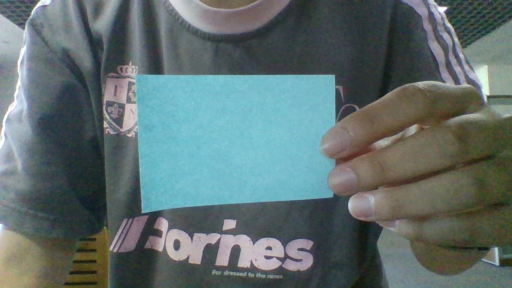
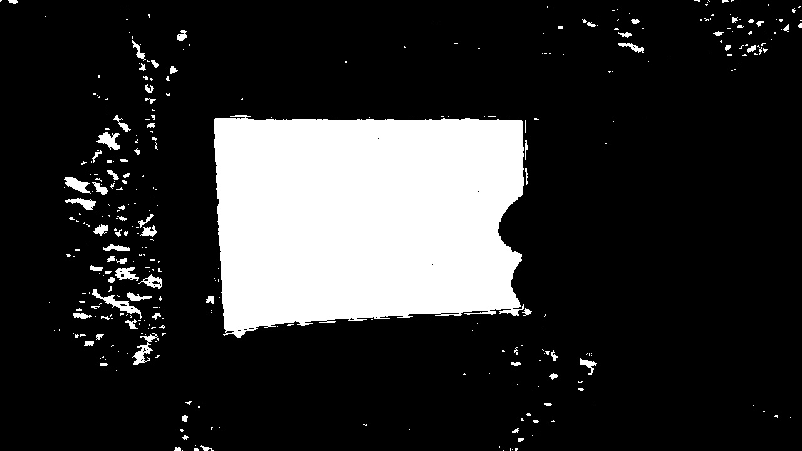
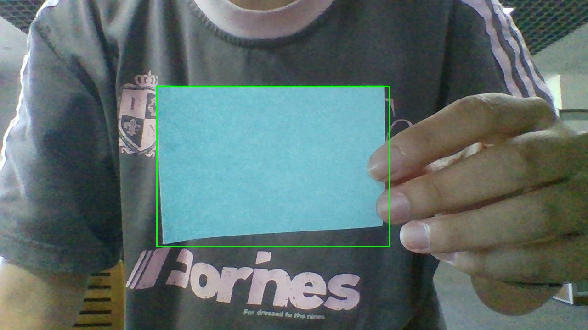

# P4_5:opencv检测的C++重写

## 功能
- 通过两层(HSV阈值和面积约束)检测选中目标

## 运行
cmake -B build && cmake --build build && ./build/vision

## 检测效果
原图:

mask:

检测结果:

## 调参记录
- HSV阈值沿用P4校准值
- S下线收紧到92,第一版mask中淡蓝色背景大面积通过阈值,最大轮廓被放大,提高饱和度后得到改善
- 遗留问题:mask仍有少量噪点,因面积过滤已隔离,不影响目标检测结果,暂不处理

## 收获
- 阈值法具有场景依赖性
- 调试步骤:看数据->提假设->修改->验证